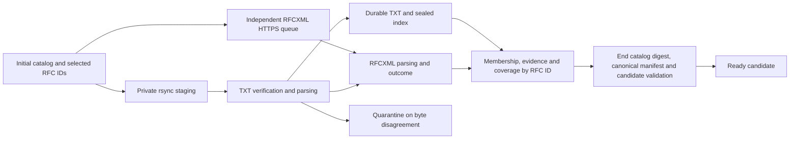
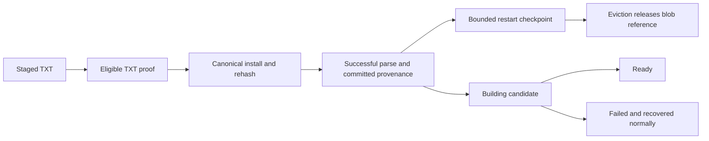

# RFC discovery and candidate ingestion

HTTPS-first Phase 5 runs the same discovery and durable processing for
manual requests and daemon jobs. It installs original HTTPS TXT and RFCXML
in BLAKE3 CAS, seals TXT indexes in PostgreSQL schema 11, and joins both
outcomes in the Sync coordinator. Each required TXT receives a current rsync
audit or a fresh dual-source byte comparison. Manual reconciliation prepares
a ready candidate. The daemon promotes its own full candidates. The qualified
schema 9 release supplies production ingestion.
[HTTPS-first design](decisions/0010-https-first-rfc-synchronization.md)

## Sync configuration

Use the [schema v2 TOML example](../deploy/ingestion.toml.example). Compose
requires the host file named by `RFC_SYNC_CONFIG_HOST_FILE` and mounts it
read-only for Sync at `RFC_SYNC_CONFIG_FILE`. The file must be regular UTF-8
and at most 16 KiB. Standalone Sync uses safe defaults when the file path is
unset. A configured path must resolve to a readable file. Validation precedes
database connections, source requests, and queue changes. Feed retains its
own format and cadence. [Control and Feed](control.md)

| Active setting | Default | Range |
| --- | ---: | ---: |
| `ingestion.max_accepted_bytes` | 4294967296 | 1–4294967296 |
| `ingestion.discovery.inventory_timeout_seconds` | 120 | 5–120 |
| `ingestion.discovery.full_reconcile_interval_seconds` | 86400 | 3600–604800 |
| `ingestion.https.max_in_flight_requests` | 2 | 1–2 |
| `ingestion.https.min_request_start_interval_ms` | 1000 | 1000–60000 |
| `ingestion.https.request_timeout_seconds` | 30 | 5–30 |
| `ingestion.https.max_attempts` | 3 | 1–3 |

The accepted-byte limit covers original captures and reused inputs. Discovery
also applies it to canonical TXT rehashes. The ten-minute discovery deadline
applies independently of acquisition and audit. Sync schedules opening and closing
catalog captures, TXT, RFCXML, Feed polls, and retries under one request
budget. Valid `Retry-After` on 429 or 503 applies to all classes and survives a
process handoff. Acquisition makes up to three attempts per artifact. A
delay above 30 seconds ends immediate retries. The 900-second target is
informational.

The pipeline table controls descriptor queue depths, the active artifact
window, parser workers, and raw and parse budgets. The active window
requires a reservation of 16 MiB of raw capacity and 128 MiB of parse
capacity per slot. `ingestion.database.batch_size` caps each checkpoint
transaction at 32 available results by default (range 1–32). The active
window can make a batch smaller. Revalidation defaults to one rsync session,
a 512-file batch, a 120-second session timeout, and three attempts with
jittered backoffs of 5 and 30 seconds. The batch also has a 256 MiB cap.
Periodic full reconciliation uses the shorter of the discovery and
revalidation intervals, both one day by default.

Run `rfc-mcp-docker-sync --check-config` with the HTTPS acquisition overlay
to report effective configuration, the publication gate, scratch and
cgroup capacity, and free bytes and inodes on the spool and audit mounts.
It performs local
checks before connecting to PostgreSQL or upstream. Sync uses its startup
snapshot until restart. [Spool and shadow setup](deployment.md#https-first-phase-5-shadow-runbook)

### Translate v1 settings

Start with the v2 example. Preserve explicit values for `max_accepted_bytes`,
`max_in_flight_requests`, `min_request_start_interval_ms`,
`request_timeout_seconds`, and `parser_workers` within the v2 bounds.
Rename `rfcxml_max_attempts` to `max_attempts` and
`max_pending_documents` to `max_active_documents`. Set
`RFC_SYNC_HTTP_CONCURRENCY` and `RFC_SYNC_PARSE_CONCURRENCY` values in
their TOML equivalents and remove both old environment variables. Remove
`txt_provenance`, `[ingestion.rsync]`, and the legacy bulk overlay.
Choose inventory and audit timeouts from their individual v2 fields.
Keep the v1 file and its matched images for the existing deployment.

## Run acquisition

Use a disposable project with a private upstream fixture for qualification.
The existing manual command takes `--full` or `--sample`. The sample
selects RFCs 2119, 8174, and 9110. In the Compose project, an invocation
while the daemon runs uses its private Sync-UID socket. A matching request
joins the active run. One different-scope request may wait for the next
run. With the daemon stopped, the CLI acquires the deployment lease and
runs directly. A ready report includes `generation_id`, `manifest_digest`,
`expected_publication_sequence`, and `promotion_deadline_us` in Unix epoch
microseconds. If a manual invocation attaches to a daemon-owned automatic run,
it receives that run's publication outcome. [Publication commands](publication.md#operator-commands)

~~~sh
docker compose -f compose.yml -f deploy/compose.https-acquisition.yml \
  run --rm --no-deps rfc-mcp-docker-sync --phase2-reconcile --sample
docker compose -f compose.yml -f deploy/compose.https-acquisition.yml \
  exec -T rfc-mcp-docker-sync /usr/local/bin/rfc-mcp-docker-sync --phase2-reconcile --full
~~~

The opening HTTPS catalog supplies the expected TXT set. A bounded rsync
inventory classifies mirror availability. New required TXT that has yet to
appear on the mirror defers the run. Loss of incumbent required TXT,
invalid inventory, local canonical corruption, and unequal opening and
ending catalog bytes fail the run.

On a cold run, the two queues request required TXT and RFCXML from HTTPS.
An existing TXT observation can be reused if it proves capture from the
official HTTPS URL, the canonical file rehashes correctly, and the mirror
inventory reports compatible size. The observation keeps its original
verification method. Newly captured TXT records `https_capture`. Both
cases produce audit-pending inputs. A successful TXT checkpoint pins
both the original and its sealed index, even while RFCXML is pending.
RFCXML is independently classified as captured, reused, 404, 410,
malformed, retries exhausted, or fetch failed.

### Restart durable processing

Run the same reconciliation again after an interruption. Sync matches
checkpoints by scope, exact catalog selection, source, processing
versions, and publication sequence. It verifies canonical length and
BLAKE3 before reusing the original observation and indexes. A missing
checkpoint object is reacquired. A corrupt object stops the run for repair.
Restore verified bytes from a matched backup before retrying a canonical
corruption incident. A changed ending catalog invalidates that selection's
checkpoints.

The checkpoint cap is 40,000 records and 4 GiB of original bytes counted
per record. TXT checkpoints expire seven days after first recording.
Positive RFCXML checkpoints and malformed capture evidence expire
24 hours after capture. Reuse keeps the original observation and expiry.
Readiness clears checkpoints in the transaction that seals generation
membership. An interrupted run can reuse its unexpired audit receipts when
the catalog selection, inventory, and source identity still match.
New runs request XML again after 404, 410, malformed content, or fetch
failure. Expired and evicted artifacts become reclaimable through
`--phase3-recover` when the incumbent and retained generations have no
references to them.

The terminal report distinguishes downloaded, reused, sealed and
TXT awaiting audit, classified RFCXML, and joined documents. It includes
the processing digest, queue and disk peaks, parser CPU time, CAS time,
and DB transaction counts. `acquisition_complete` means both artifacts
have terminal results for every selected RFC under the ending catalog
fence. `txt_audited` includes qualified matches and repaired originals.
`membership_committed` remains zero until the publication phase. The per-run
spool is cleaned after success and cooperative shutdown, or swept on the
next run after a crash. Deferred and failed manual runs return nonzero.
[Control behavior](control.md#reconciliation-and-publication)

## Audit and repair

Sync stages private copies of sealed HTTPS TXT bytes and runs an rsync checksum
dry run with `--checksum-choice=auto`. A complete, successful session must
explicitly account for every selected file. Sync verifies the staged bytes
again before committing the receipt. A checksum match records that the
packaged client compared the local and remote files using its pre-transfer
checksum. Repair records a stronger byte comparison from fresh HTTPS and
rsync captures. RFCXML records HTTPS transport provenance and an inapplicable
rsync audit until an equivalent official XML artifact is qualified.

A required TXT mismatch triggers a fresh capture from each source through
the same HTTPS start gate and the single rsync session budget. Matching
originals are sealed and rejoined using the HTTPS bytes. Diverging pairs are
quarantined with their observation times, source URLs, and digests. The
private 1 GiB mount holds scope journals capped at 64 MiB total and quarantine
capped at 256 MiB, 128 pairs, and seven days. Sync reports required TXT as
unresolved on exhausted retries or full quarantine. Receipts from interrupted
runs are reusable only within the same fresh selection and source identity.
A completed run requires a fresh audit on the next reconciliation.

## Schema 9 release pipeline

The following sections describe the deployed schema 9 collector and its
historical qualification. Use the corresponding release checkout for its
configuration and runtime commands.

## Pipeline and recovery

Bulk mode runs one rsync session for the selected RFCs. It keeps full and sample working trees on a separate capped filesystem. Sync checks the rsync receipt and the complete inventory before admitting TXT files. Subsequent sessions use the existing files as checksum-verified transfer bases. A failed or interrupted session can leave some files updated. A retry must finish a fresh rsync session and validate the whole selection before using those bytes. [Schema 9 bulk mount provisioning](deployment.md#bulk-rsync-staging)



In batched mode, Sync stages at most 32 TXT files of up to 4 MiB each and starts the next batch after removing the previous staging directory. In both modes RFCXML fills the pending-document window immediately after catalog selection, even during rsync. Parsed TXT can be installed and indexed while its XML request is pending. Each completed RFC frees its own slot, so a later RFC can finish and admit more work while an earlier request is slow. The default three slots reserve at most 48 MiB for raw payloads, including one RFCXML body per slot. Each document shares a 128 MiB application parse budget between TXT and RFCXML, with the existing XML node and work limits. Catalog processing runs outside the document window and has a 20,000-entry cap.

- The shared HTTPS start gate spaces catalog, TXT, and RFCXML dispatches by the configured interval even when two responses overlap. Hourly catalog probes and reconciliations sharing the mirror also share the corpus fence. Each new lock holder waits for the configured interval before starting HTTPS.
- RFCXML retries timeouts, interrupted transfers, and HTTP 429, 500, 502, 503, and 504. The default allows two retries with jittered one- and two-second backoffs. A valid `Retry-After` on RFCXML 429 or 503 delays new HTTPS starts for all sources in that run. Values above 30 seconds end retries for that RFC and keep the shared delay, subject to the run deadline.
- The reconciliation report's `rfcxml` counters distinguish valid captures, 404, 410, malformed responses that passed HTTPS body validation, exhausted retries, and terminal fetch failures. The legacy `xml_unavailable` count still includes 404, 410, and fetch failures. HTTPS evidence for malformed XML preserves the captured bytes. Only valid parsed results supply RFCXML relations. A 404 or 410 uses normal TXT fallback. Failure or malformed XML caps otherwise complete fallback reference coverage at partial. Metrics include dispatched retries, peak lookahead, reserved bytes, and shared HTTPS concurrency and start spacing.
- One writer seals TXT indexes as results arrive. A second transaction inserts the immutable membership row, RFCXML observation when available, relation evidence and coverage for the same generation, starting catalog, and RFC. The manifest sorts its inputs canonically before the candidate becomes ready.
- On fatal failure, timeout, or SIGTERM, Sync stops admission, cancels HTTPS work and retry waits, reaps rsync, and joins parsing and any active blob install before releasing the corpus fence. It awaits the result of an already submitted readiness commit. Recovery reclaims early sealed indexes and blobs without surviving generation references. [Publication and recovery](publication.md)
- To reduce overlap, set both concurrency settings to `1` in TOML. For policy or schema rollback, follow the [deployment upgrade procedure](deployment.md#initialize-or-upgrade).

### TXT provenance and reuse

The default `dual_source` policy checks new TXT against the HTTPS body. A full ready, published, or retained baseline may supply a prior HTTPS-verified observation when the staged digest and full canonical bytes agree. A missing canonical file requires fresh HTTPS verification. A conflicting canonical file fails the run for investigation.

New byte matches bind separate rsync and HTTPS observations for the same RFC and BLAKE3 digest. The HTTPS observation remains the TXT citation and points to the matching rsync observation. The stored verification method distinguishes `dual_source`, `legacy_https_verified`, `rsync_integrity` and `https_capture`. Legacy records retain their original IDs and timestamps. HTTPS capture describes transport even when an RFCXML body cannot be parsed. The reconciliation report counts fresh matches, reused dual-source or legacy proofs, and mismatches separately. Disagreeing originals are kept in private quarantine.

With `persistent_bulk`, an operator can opt in to `rsync_bootstrap`. A full run at publication sequence zero then accepts TXT from the official rsync module with local checksum and CAS integrity checks. The rsync transport lacks the authentication supplied by HTTPS. The stored observation records the rsync URL and marks HTTPS verification as `unverified`. Its fetch time is the successful session completion for a transferred file. A checksum-confirmed cache hit has a new observation time and a null fetch time. Sample runs remain strict.

After the first publication, `rsync_bootstrap` requires an HTTPS comparison for new or changed TXT. An unchanged TXT can reuse its active generation observation only after rechecking the staged bytes against the canonical blob and its digest. A candidate prepared before a different first publication must still pass the active provenance check at promotion. The report counts HTTPS-verified and rsync-only TXT separately. The reused count includes both kinds of prior proof.

The rsync metrics report session count, transferred file count, checksum hits and maximum validated inventory bytes. On a warm bulk run the validated inventory includes files whose content rsync confirmed without transferring.

### Reconciliation progress

Sync emits an aggregate `ingestion_progress` record every 60 seconds during an active generation. The generation ID connects these records to the terminal candidate report. Daemon runs also include the job ID, which links a candidate to the separate `publication` record. A `ready` result means the candidate was committed. A successful `publication` records the expected and committed sequences. A failed promotion reports the failed attempt while the database remains the source of truth for candidate state and commit outcome.

TXT completion counts durably sealed TXT. XML completion counts committed membership with a classified XML outcome, including recorded unavailability and errors. Remaining counts describe unfinished selected work. Queue counts describe admitted documents and reserved XML slots, with high-water marks in the terminal metrics. On failure, the counts retain the point where work stopped. The report separates HTTPS body bytes read, logical TXT bytes in successfully transferred rsync files, validated rsync inventory size, and accepted input bytes. CPU and memory peaks are process or container measurements. The timing fixture additionally samples disk allocations for the mirror, PostgreSQL and bulk staging.

### Interrupted reconciliation



New verified TXT and successfully parsed RFCXML get their own committed checkpoints. Each checkpoint pins the original observation and canonical bytes independently of candidate state. A retry creates a new candidate, fetches the current catalog, and matches its exact digest, scope, effective TXT policy, publication sequence, parser and index versions, and registry version. A catalog mismatch at the end invalidates the attempt's checkpoints. Successful readiness clears them in the same transaction as the manifest.

Sync still stages the selected TXT on retry. It uses a completed-generation baseline first where the policy permits, and only reuses a checkpoint when the staged and canonical bytes agree. It reparses TXT with the current parser. Sync rehashes and reparses cached RFCXML and uses the original observation and timestamps. Reports count these as `checkpoint_txt` and `rfcxml.reused`. The `rfcxml.captured` counter counts fresh valid captures. An expired RFCXML checkpoint is fetched through the regular HTTPS queue, where a fresh 404 or 410 uses normal TXT fallback. Parse errors and failed requests never produce a checkpoint. A missing canonical file can be reacquired. A conflicting canonical file invalidates the checkpoint and stops the attempt for repair.

The cache admits up to 40,000 source records and 4 GiB of recorded body bytes across full and sample runs. Each record counts its length against the budget even when bytes are shared. TXT entries expire seven days after checkpoint creation, and RFCXML entries expire 24 hours after the original HTTPS fetch. Reuse keeps those deadlines. Sync removes expired entries and evicts the oldest remaining entries when space is needed. A crash before a checkpoint commits leaves the newly installed file eligible for ordinary GC.

## Bootstrap qualification

The production template uses strict TXT verification and batched rsync. To opt in to persistent bulk staging and accept rsync-only TXT evidence at sequence zero, set `ingestion.txt_provenance = "rsync_bootstrap"` and `ingestion.rsync.mode = "persistent_bulk"`. Use the dedicated staging filesystem, then run `--check-config`. Use the [deployment procedure](deployment.md#first-publication) to check the active generation, pinned MCP read, and outbox. [Return to strict batched ingestion](deployment.md#return-to-strict-batched-ingestion)

The 900-second objective measures a cold initialization from the first volume ownership step through publication, `/ready` and a byte-exact MCP read. Record authenticated notification delivery and image preparation separately. A planning corpus of 9,861 RFCs needs 9,863 HTTPS starts for XML and the two catalog captures. With the one-second minimum, their first-to-last start window alone is at least 9,862 seconds (2 h 44 min 22 s). Strict cold TXT verification increases the floor to 19,723 seconds. Private accelerated measurements describe the local collector. The production objective is infeasible at current pacing. [Timing contract and rate calculation](decisions/0009-cold-rfc-bootstrap.md)

Load matching native service and fixture images, including the publication and control fixtures, into the target Docker context. Use the pinned PostgreSQL image from the fixture Compose file. These commands use the private upstream and a new evidence directory for each profile.

```sh
evidence=$(mktemp -d /tmp/rfc-dual-qualify.XXXXXXXX)
for profile in quick paced full rollback; do
    python3 -B scripts/bootstrap/baseline.py --phase8 "$profile" --context default \
        --image-prefix "$IMAGE_PREFIX" --evidence "$evidence/$profile"
done
python3 -B scripts/bootstrap/image-cache.py --context default \
    --image-prefix "$IMAGE_PREFIX" --evidence "$evidence/image-cache"
python3 -B scripts/phase2/integration.py --context default \
    --image-prefix "$IMAGE_PREFIX" --benchmark 96 --repeats 3 \
    --serial-image-prefix "$SERIAL_IMAGE_PREFIX" --receipt "$evidence/serial.json"
```

The paced, full and rollback profiles need a host that permits the disposable ext4 mount under `/tmp` and the associated disk sampling. The full profile runs three cold and incremental pairs. Run it on an otherwise idle host. Incremental MCP timing uses the byte-reviewed RFC 2119 fixture at the new sequence. The harness separately checks the MCP source-policy response and verifies the changed synthetic original against its canonical bytes. The image-cache probe uses isolated Docker and containerd stores and sockets under `/tmp` for a checksum-verified offline import. The historical serial prefix uses revision `e2e5a41` and its matching Sync and ingestion-fixture images. [Observed results and prerequisites](implementation-status.md)

## Reading candidate metadata

- Manifest format 2 extends format 1 with the scope, the two catalog observation identities, the policy registry version, and catalog entries without TXT. A generation records the exact publication date or its available month precision.
- The document version stores LF-based line starts and section coverage. Section IDs are scoped to the document version. Raw headings, section bodies, and notices are half-open original byte ranges. Use the original blob to reconstruct matches and snippets.
- PostgreSQL chunks hold consecutive raw UTF-8 slices of at most 16 KiB. Document lexemes come from the intact TXT under pg_catalog.simple, so terms in separate chunks and terms split by a chunk boundary remain searchable together.
- Accepted TXT with invalid UTF-8 or a NUL byte is stored byte for byte in bytes mode. It retains LF line offsets, with text indexing and parsed TXT sections, notices, and references unavailable. Catalog metadata and independently verified RFCXML evidence are still available. The reconciliation report counts `invalid_utf8` and `contains_nul` independently. A body with both conditions contributes to both counters.
- Catalog and RFCXML evidence locators encode half-open byte ranges in their respective XML observation blobs. TXT evidence uses original TXT offsets. Global reference coverage is partial where sources are excluded, unavailable, or incomplete.
- A complete notice extraction describes the parser's result. Redistribution review comes from the [notice registry](../crates/sync/src/policy.json). The reviewed fixture digests permit whole-document reproduction. Other documents default to metadata-only policy.

## Repeat verification

~~~sh
scripts/phase0/check-rust.sh
python3 scripts/phase0/integration.py --project rfc-phase2-regression
python3 scripts/phase1/integration.py --image-prefix rfc-phase2-regression
python3 scripts/phase2/integration.py
~~~

The fixture profile uses synthetic sources and the two reviewed RFC originals. The benchmark uses disposable projects and fixed fixture observation timestamps. Compare with `--benchmark 6 96 --http-concurrency 1` and again with `--http-concurrency 2`. Use `--receipt /tmp/benchmark.json` for the per-run results and `--reference-receipt /tmp/serial.json` for comparison with a reference that uses the same observation identities. The fixture pace matches the official dispatch interval by default. Run `--live` only with explicit upstream authorization.

Use Phase 2's `--bulk` for strict cold and warm bulk reconciliation and `--bulk-bootstrap` for rsync-only provenance, faults and promotion. Phase 6's `--bulk-bootstrap` exercises daemon publication and an MCP read. These offline profiles require `mkfs.ext4` and permission to mount a disposable loop filesystem under `/tmp`. For the populated schema 7 upgrade drill, pass `--upgrade-from-schema7` with the prefix of prebuilt schema 7 Sync and ingestion fixture images. Phase 3's `--checkpoints` runs the restart, expiry, quota and corruption probes.
