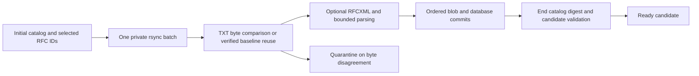
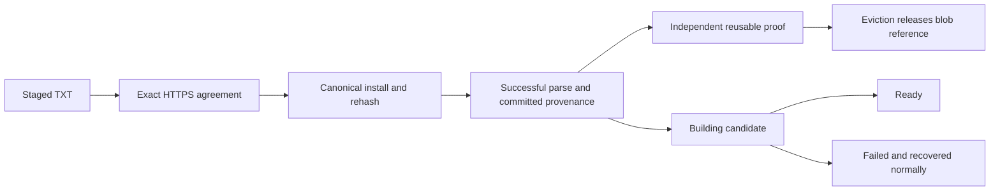

# Phase 2 candidate ingestion

Provision the mirror and PostgreSQL 19 roles using the [storage instructions](storage.md). Run the sync image as UID 10002 in Docker Compose with the writable mirror, the scoped sync credentials, and outbound access to RFC Editor over HTTPS and rsync. Compose gives sync a private 512 MiB tmpfs at `/tmp`, a 2 GiB memory limit, and two CPUs. Size the host for the sync cgroup, including its tmpfs use. [Disposable Compose live profile](../scripts/phase2/live.yml)

Use these commands in a Compose project configured with the sync service.

~~~sh
docker compose run --rm --no-deps sync --phase2-reconcile --full
docker compose run --rm --no-deps sync --phase2-reconcile --sample
~~~

Full mode reconciles the expected TXT set from the RFC Editor catalog. Sample mode uses RFCs 2119, 8174, and 9110 and records its restricted scope. A missing expected TXT, a lost previously accepted RFC, a byte disagreement, or catalog drift fails the run. The JSON report identifies the failed input when available and includes a generation ID, digest, counts, and coverage warnings. For a disagreement, sync saves both originals and their digests in /mirror/quarantine. Only sync can read that directory. An abrupt interruption can leave a building generation and durable blobs for Phase 3 recovery.

The collector bounds requests, disk staging, and accepted input. HTTPS requires the RFC Editor hostname and native trust roots. The collector rejects redirects and encoded bodies. Rsync uses catalog-derived filenames and transfers into a fresh private directory. A previous verified TXT observation is eligible for reuse when the staged bytes and the canonical blob match its digest.

## Pipeline and recovery

At most 32 TXT files of up to 4 MiB each are staged per batch. Sync takes a document out of staging only after admitting it to the three-document window. The next batch starts after the previous staging directory has been removed. Three slots reserve at most 48 MiB for document payloads. Each admitted document has a 128 MiB application parse budget, with the existing TXT and RFCXML input caps and XML node limits. Catalog processing runs outside the document window. The 20,000-entry, 4 GiB accepted-input, and 12-hour limits continue to apply.

- `RFC_SYNC_HTTP_CONCURRENCY` sets the in-flight HTTPS limit and accepts `1` or `2`. It defaults to `2`. The shared start gate spaces catalog, TXT, and RFCXML dispatches by at least one second even when two responses overlap. Hourly catalog probes and reconciliations sharing the mirror also share the corpus fence. Each new lock holder allows a one-second handoff interval before starting HTTPS.
- `RFC_SYNC_PARSE_CONCURRENCY` sets the blocking parser limit and accepts `1` or `2`. It defaults to `1`. The writer commits in ascending RFC order and ends each document transaction before taking the next prepared result. One supervised blocking task at a time performs blob installation and fsync so transfers can continue while the writer waits.
- On failure, timeout, or SIGTERM, sync stops admission, cancels HTTPS work, reaps rsync, and joins parsing and any active blob install before releasing the corpus fence. Phase 3 recovery handles unfinished generations and orphaned blobs after an abrupt interruption. Existing optional RFCXML handling still records partial coverage for unavailable or invalid reference evidence as appropriate. [Publication and recovery](publication.md)
- To reduce overlap, set both concurrency settings to `1` in the sync environment. To roll back the code, stop sync gracefully, pin the previous sync image, and restart using the existing database schema and mirror. Keep the larger sync mount so the serial collector can stage a full batch.

### Verified TXT reuse

A full ready, published, or retained baseline may supply a prior TXT observation. The observed source URL and verification state, staged digest, and full canonical bytes must agree. A missing canonical file requires fresh HTTPS verification. A conflicting canonical file fails the run for investigation.

A future failed-run cache could retain one independent proof per RFC ID, exact TXT digest, and official source URL.

A proof would pin its canonical blob through a reference independent of candidate state. To reuse it, check current catalog membership and staged bytes, revalidate the blob, and rebuild indexes with the current parser. Normal baseline reuse takes precedence. A proposed starting policy is seven days from verification, 4,096 proofs, and 512 MiB of uniquely referenced TXT. Expire old proofs, then evict least recently used proofs to satisfy both limits. A future additive migration would make proof insertion and removal atomic with the provenance and deletion queue under the coordinator fence. A crash before proof commit leaves the blob eligible for normal recovery. The current implementation uses full-generation baseline reuse.

## Reading candidate metadata

- Manifest format 2 extends format 1 with the scope, the two catalog observation identities, the policy registry version, and catalog entries without TXT. A generation records the exact publication date or its available month precision.
- The document version stores LF-based line starts and section coverage. Section IDs are scoped to the document version. Raw headings, section bodies, and notices are half-open original byte ranges. Use the original blob to reconstruct matches and snippets.
- PostgreSQL chunks hold consecutive raw UTF-8 slices of at most 16 KiB. Document lexemes come from the intact TXT under pg_catalog.simple, so terms in separate chunks and terms split by a chunk boundary remain searchable together.
- Verified TXT with invalid UTF-8 or a NUL byte is stored byte for byte in bytes mode. It retains LF line offsets, with text indexing and parsed TXT sections, notices, and references unavailable. Catalog metadata and independently verified RFCXML evidence are still available. The reconciliation report counts `invalid_utf8` and `contains_nul` independently. A body with both conditions contributes to both counters.
- Catalog and RFCXML evidence locators encode half-open byte ranges in their respective XML observation blobs. TXT evidence uses original TXT offsets. Global reference coverage is partial where sources are excluded, unavailable, or incomplete.
- A complete notice extraction describes the parser's result. Redistribution review comes from the [notice registry](../crates/sync/src/policy.json). The reviewed fixture digests permit whole-document reproduction. Other documents default to metadata-only policy.

## Repeat verification

~~~sh
scripts/phase0/check-rust.sh
python3 scripts/phase0/integration.py --project rfc-phase2-regression
python3 scripts/phase1/integration.py --image-prefix rfc-phase2-regression
python3 scripts/phase2/integration.py
~~~

The fixture profile uses synthetic sources and the two reviewed RFC originals. The benchmark uses disposable projects and fixed fixture observation timestamps. Compare with `--benchmark 6 96 --http-concurrency 1` and again with `--http-concurrency 2`. Use `--receipt /tmp/benchmark.json` for the per-run results and `--reference-receipt /tmp/serial.json` for comparison against the instrumented serial revision. The fixture pace matches the official dispatch interval by default. Run `--live` only with explicit upstream authorization.
